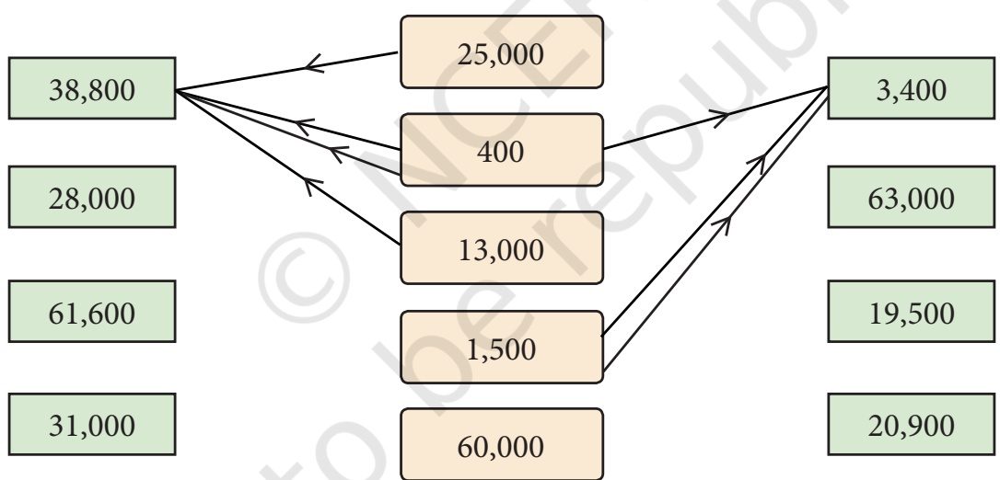

b. the difference between the largest and smallest numbers less than 5085.

c. the sum of the largest and smallest numbers greater than 9779.

d. the sum of the largest and smallest numbers less than 9779.

2. What is the sum of the smallest and largest 5-digit palindrome? What is their difference?

3. The time now is 10:01. How many minutes until the clock shows the next palindromic time? What about the one after that?

4. How many rounds does the number 5683 take to reach the Kaprekar constant?

## 3.8 Mental Math

Observe the figure below. What can you say about the numbers and the lines drawn?

Numbers in the middle column are added in different ways to get the numbers on the sides (1500 + 1500 + 400 = 3400). The numbers in the middle can be used as many times as needed to get the desired sum. Draw arrows from the middle to the numbers on the sides to obtain the desired sums.

Two examples are given. It is simpler to do it mentally!

$$
38,800=25,000+400\times 2+13,000
$$