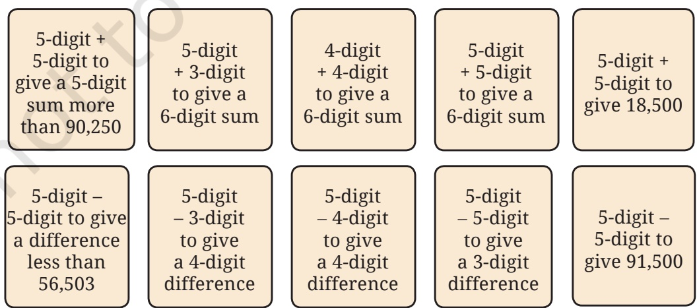

Can we make 1,000 using the numbers in the middle? Why not? What about 14,000, 15,000 and 16,000? Yes, it is possible. Explore how. What thousands cannot be made?

## Adding and Subtracting

Here, using the numbers in the boxes, we are allowed to use both addition and subtraction to get the required number. An example is shown.

40,000

7,000

$$
39,800=40,000-800+300+300
$$

45,000 =

300

1,500

$$
5{,}900=
$$

$$
^ { 1 7 , 5 0 0 } \exists
$$

12,000

800

$$
21{,}400=
$$

## Digits and Operations

An example of adding two 5-digit numbers to get another 5-digit number is 12,350 + 24,545 = 36,895.

An example of subtracting two 5-digit numbers to get another 5-digit number is 48,952 – 24,547 = 24,405.

## Figure it Out

possible.

