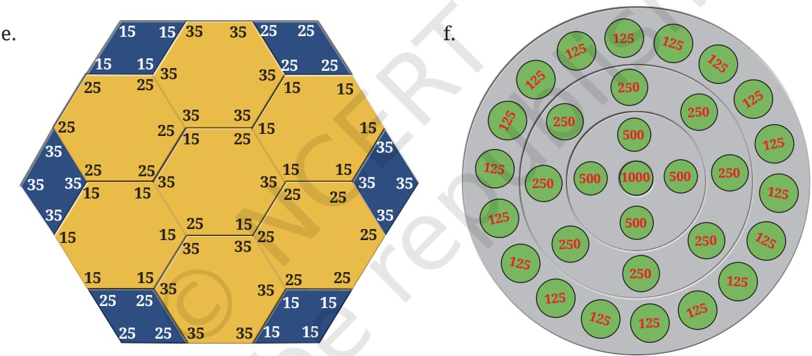
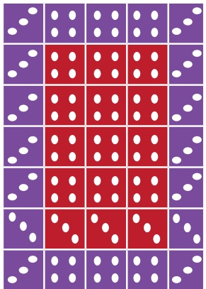

c.

<table><tbody><tr><td>32</td><td>32</td><td>32</td><td>32</td><td>32</td><td>32</td><td>32</td><td>32</td></tr><tr><td>32</td><td>32</td><td>32</td><td>32</td><td>32</td><td>32</td><td>32</td><td>32</td></tr><tr><td>32</td><td>32</td><td>32</td><td>32</td><td>32</td><td>32</td><td>32</td><td>32</td></tr><tr><td>32</td><td>32</td><td>32</td><td>32</td><td>32</td><td>32</td><td>32</td><td>32</td></tr><tr><td>64</td><td>64</td><td>64</td><td rowspan="4" colspan="4"></td><td>64</td></tr><tr><td>64</td><td>64</td><td>64</td><td>64</td></tr><tr><td>64</td><td>64</td><td>64</td><td>64</td></tr><tr><td>64</td><td>64</td><td>64</td><td>64</td></tr></tbody></table>

d.

## 3.10 An Unsolved Mystery — the Collatz Conjecture!

Look at the sequences below—the same rule is applied in all the sequences:

a. 12, 6, 3, 10, 5, 16, 8, 4, 2, 1

b. 17, 52, 26, 13, 40, 20, 10, 5, 16, 8, 4, 2, 1

c. 21, 64, 32, 16, 8, 4, 2, 1

d. 22, 11, 34, 17, 52, 26, 13, 40, 20, 10, 5, 16, 8, 4, 2, 1

Do you see how these sequences were formed?