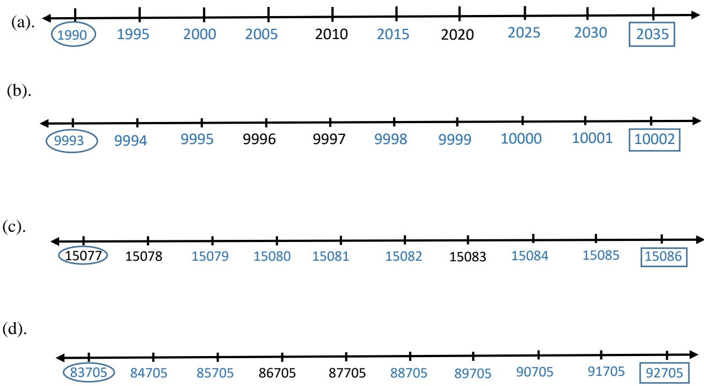

Q. Identify the numbers marked on the number lines below, and label the remaining positions.

Put a circle around the smallest number and a box around the largest number in each of the sequences above.

**Section 3.4**

**Page no. 60**

**Q. Find out how many numbers have two digits, three digits, four digits, and five digits:**

| 1 numbers | Digit 2 | Digit numbers | Digit 3 numbers | Digit 4 numbers | 5 numbers | Digit |
| --- | --- | --- | --- | --- | --- | --- |
| 9 |  |  |  |  |  |  |

Ans.

| 1 Digit numbers | 2 Digit numbers | 3 Digit numbers | 4 Digit numbers | 5 Digit numbers |
| --- | --- | --- | --- | --- |
| 9 | 90 | 900 | 9,000 | 90,000 |