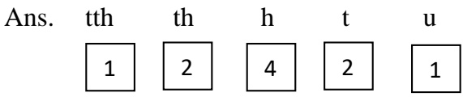

|  |
| --- |
| 321 |
| -189 792 |

## Section 3.5

## Page no. 61

**Q. Write all possible 3-digit palindromes using these digits.**

Ans. Palindromes: 111, 121, 131 222, 212, 232 313, 323, 333

## Explore

**Page no. 62**

**Q. Will reversing and adding numbers repeatedly, starting with a 2-digit number, always give a palindrome? Explore and find out.\***

<table><tr><td colspan="2">Some of these are-</td></tr><tr><td>12</td><td>47</td></tr><tr><td>+21 33</td><td>+74 121</td></tr></table>

Try more

Yes, it will always give a palindrome.

## Puzzle time

**Q. I am a 5-digit palindrome. I am an odd number. My ‘t’ digit is double of my ‘u’ digit. My ‘h’ digit is double of my ‘t’ digit.** Who am I?

Twelve thousand four hundred twenty one.

## Section 3.6

**Page no. 63**

**Q. Carry out these same steps with a few 3-digit numbers. What number will start repeating?**

Ans.

The number 495 starts repeating.

963 <u>-369</u> 594

954 <u>-459</u> 495

954 <u>-459</u> 495

Try for other 3-digit numbers.