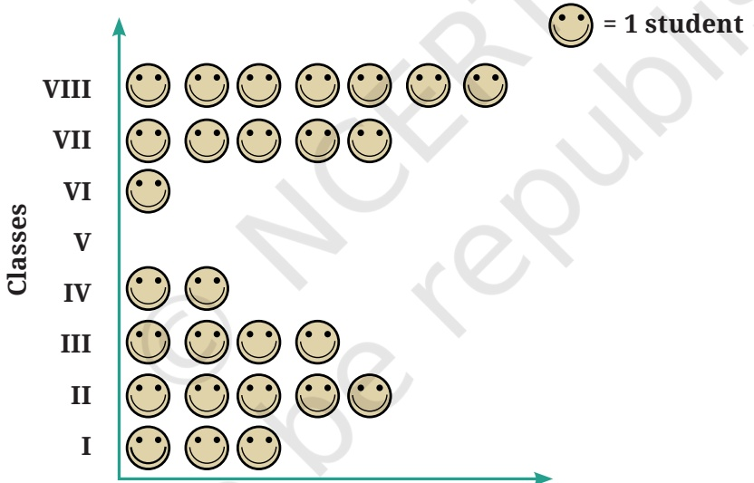

3. There are 4 complete pictures for ‘Never’. Hence, 4 × 10 = 40 children never sleep at least 9 hours in a night, i.e., they always sleep less than 9 hours.

## Drawing a Pictograph

One day, Lakhanpal collected data on how many students were absent in each class:

| Class | I | II | III | IV | V | VI | VII | VIII |
| --- | --- | --- | --- | --- | --- | --- | --- | --- |
| No. of students | 3 | 5 | 4 | 2 | 0 | 1 | 5 | 7 |

He created a pictograph to present this data and decided to show 1 student as in the pictograph —

**= 1 student**

No. of students absent

Meanwhile, his friends Jarina and Sangita collected data on how many students were present in each class:

| Class | I | II | III | IV | V | VI | VII | VIII |
| --- | --- | --- | --- | --- | --- | --- | --- | --- |
| No. of students | 30 | 35 | 20 | 25 | 30 | 25 | 30 | 20 |