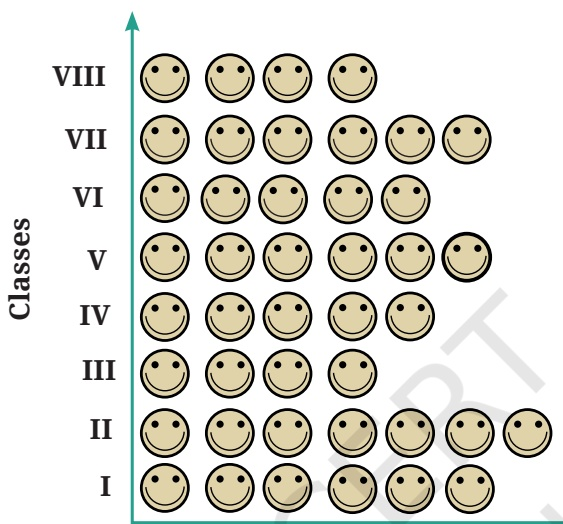
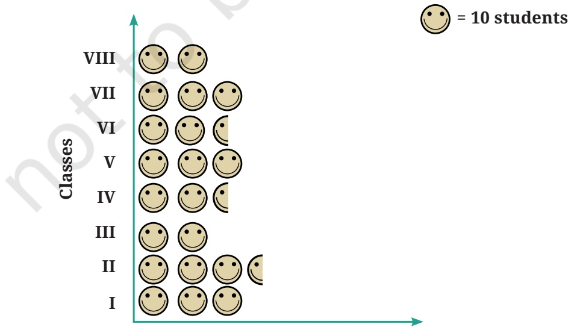

If they want to show their data through a pictograph, where they also use one symbol for each student, as Lakhanpal did, what are the challenges they might face?

Jarina made a plan to address this — since there were many students, she decided to use to represent 5 students. She figured that would save time and space too.

No. of students present

**= 5 students**

Sangita decided to use one to represent 10 students instead. Since she used one to show 10 students, she had a problem in showing 25 students and 35 students in the pictograph. Then, she realised she could use to show 5 students.

No. of students present