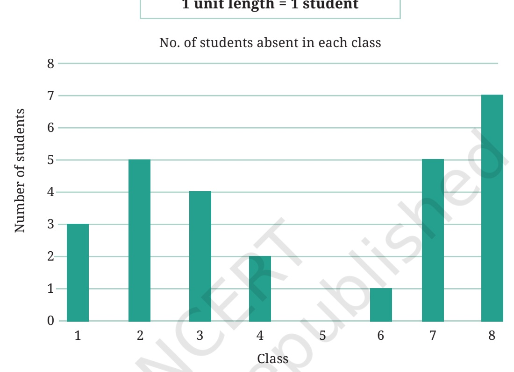

He presented the same data using a bar graph:

## Teacher’s Note

If the students have not noticed, please point out the equally spaced horizontal lines. Explain that this means that each pair of consecutive numbers on the left has the same gap.

Answer the following questions using the bar graph:

1. In Class 2, \_\_\_\_\_ students were absent that day.

2. In which class were the maximum number of students absent?

3. Which class had full attendance that day?

When making bar graphs, bars of uniform width can be drawn horizontally or vertically with equal spacing between them; then the