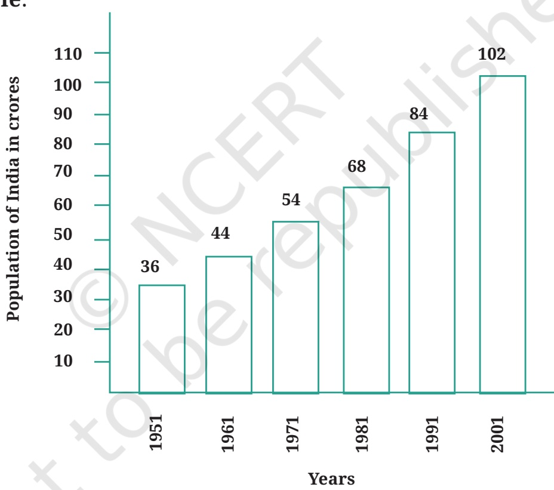

## Figure it Out

1. How many total cars passed through the crossing between 6 a.m. and noon?

2. Why do you think so little traffic occurred during the hour of 6–7 a.m., as compared to the other hours from 7 a.m.–noon?

3. Why do you think the traffic was the heaviest between 7–8 a.m.?

4. Why do you think the traffic was lesser and lesser each hour after 8 a.m. all the way until noon?

## Example:

Population of India in crores

This bar graph shows the population of India in each decade over a period of 50 years. The numbers are expressed in crores. If you were to take 1 unit length to represent one person, drawing the bars will