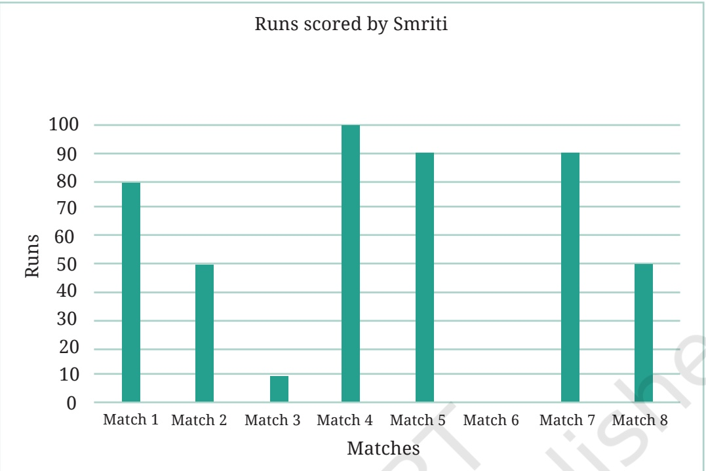

**Example**: The following table shows the monthly expenditure of Imran’s family on various items:

| Items | Expenditure (in `) |
| --- | --- |
| House rent | 3000 |
| Food | 3400 |
| Education | 800 |
| Electricity | 400 |
| Transport | 600 |
| Miscellaneous | 1200 |

To represent this data in the form of a bar graph, here are the steps—

• Draw two perpendicular lines, one horizontal and one vertical.

Along the horizontal line, mark the ‘items’ with equal spacing between them and mark the corresponding expenditures along the vertical line.