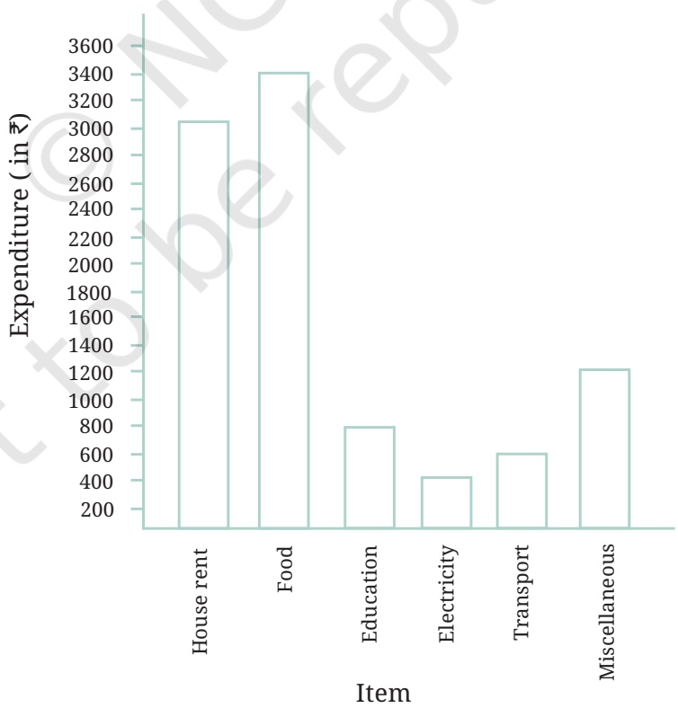

• Take bars of the same width, keeping a uniform gap between them.

Choose a suitable scale along the vertical line. Let, 1 unit length = \` 200, and then mark and write the corresponding values (\` 200, \` 400, etc.) representing each unit length.

Finally, calculate the heights of the bars for various items as shown below —

| House rent | 3000 ÷ 200 | 15 units |
| --- | --- | --- |
| Food | 3400 ÷ 200 | 17 units |
| Education | 800 ÷ 200 | 4 units |
| Electricity | 400 ÷ 200 | 2 units |
| Transport | 600 ÷ 200 | 3 units |
| Miscellaneous | 1200 ÷ 200 | 6 units |

Here is the bar graph that we obtain based on the above steps:

