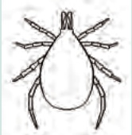
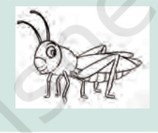

Use the bar graph to answer the following questions:

1. On which item does Imran’s family spend the most and the second most?

2. Is the cost of electricity about one-half the cost of education?

3. Is the cost of education less than one-fourth the cost of food?

## Figure it Out

1. Samantha visited a tea garden, and collected data of the insects and critters she saw there. Here is the data she collected:

<table><tr><td></td><td></td><td></td><td></td><td></td></tr><tr><td>Mites</td><td>Caterpillars</td><td>Beetles</td><td>Butterflies</td><td>Grasshoppers</td></tr><tr><td>6</td><td>10</td><td>5</td><td>3</td><td>2</td></tr></table>

Help her prepare a bar graph representing this data.

2. Pooja collected data on the number of tickets sold at the Bhopal railway station for a few different cities of Madhya Pradesh over a two-hour period.

| City | Vidisha | Jabalpur | Seoni | Indore | Sagar |
| --- | --- | --- | --- | --- | --- |
| Number of tickets | 24 | 20 | 16 | 28 | 16 |

She used this data and prepared a bar graph on the board to discuss the data with her students, but someone erased a portion of the graph.