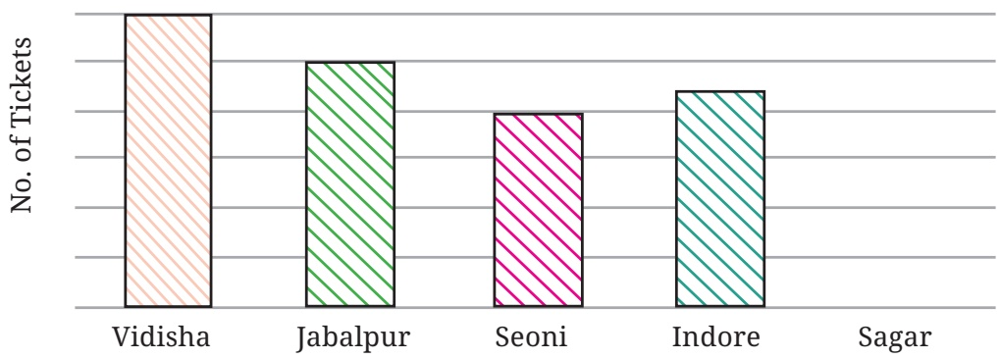

City

a. Write the number of tickets sold for Vidisha above the bar.

b. Write the number of tickets sold for Jabalpur above the bar.

c. The bar for Vidisha is 6 unit lengths and the bar for Jabalpur is 5 unit lengths. What is the scale for this graph?

d. Draw the correct bar for Sagar.

e. Add the scale of the bar graph by placing the correct numbers on the vertical axis.

f. Are the bars for Seoni and Indore correct in this graph? If not, draw the correct bar(s).

3. Chinu listed the various means of transport that passed across the road in front of his house from 9 a.m. to 10 a.m.:

<table><tr><td>bike</td><td>car</td><td>bike</td><td>bus</td><td>bike</td><td>bike</td></tr><tr><td>bike</td><td>auto rickshaw</td><td>bicycle</td><td>bullockcart</td><td>bicycle</td><td>autorickshaw</td></tr><tr><td>car</td><td>scooter</td><td>car</td><td>autorickshaw</td><td>bicycle</td><td>bike</td></tr><tr><td>car</td><td>auto rickshaw</td><td>bike</td><td>scooter</td><td>bike</td><td>car</td></tr><tr><td>bicycle</td><td>scooter</td><td>bicycle</td><td>scooter</td><td>bike</td><td>bus</td></tr><tr><td>auto rickshaw</td><td>auto rickshaw</td><td>bike</td><td>bicycle</td><td>bus</td><td>bike</td></tr><tr><td>bicycle</td><td>scooter</td><td>bus</td><td>scooter</td><td>autorickshaw</td><td>bike</td></tr><tr><td rowspan=2>scooter</td><td rowspan=2>bicycle</td><td rowspan=2>bike</td><td>bullock</td><td>auto</td><td rowspan=2>scooter</td></tr><tr><td>cart</td><td>rickshaw</td></tr><tr><td>car</td><td>scooter</td><td></td><td colspan=3></td></tr></table>