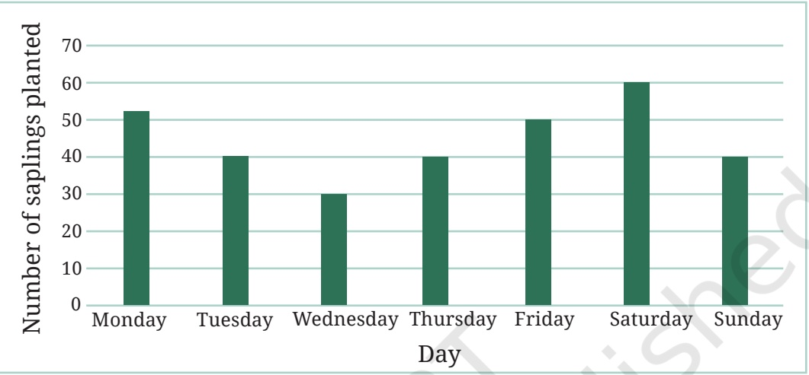

10. Students and teachers of a primary school decided to plant tree saplings in the school campus and in the surrounding village during the first week of July. Details of the saplings they planted are as follows —

a. The total number of saplings planted on Wednesday and Thursday is

b. The total number of saplings planted during the whole week is

The greatest number of saplings were planted on and the least number of saplings were planted on Why do you think that is the case? Why were more saplings planted on certain days of the week and less on others? Can you think of possible explanations or reasons? How could you try and figure out whether your explanations are correct?

11. The number of tigers in India went down drastically between 1900 and 1970. Project Tiger was launched in 1973 to track and protect the tigers in India. Starting in 2006, the exact number of tigers in India was tracked. Shagufta and Divya looked up information about the number of tigers in India between 2006 and 2022 in fouryear intervals. They prepared a frequency table for this data and a bar graph to present this data, but there are a few mistakes in the graph. Can you find those mistakes and fix them?