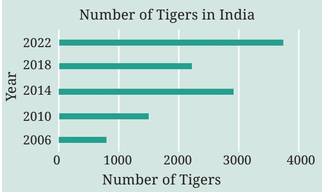

| Year | Number of Tigers (approx.) |
| --- | --- |
| 2006 | 1400 |
| 2010 | 1700 |
| 2014 | 2200 |
| 2018 | 3000 |
| 2022 | 3700 |

Like pictographs, bar graphs give a nice visual way to represent data. They represent data through equally-spaced bars, each of equal width, where the lengths or heights give frequencies of the different categories.

Each category is represented by a bar where the length or height depicts the corresponding frequency (for example, cost) or quantity (for example, runs).

The bars have uniform spaces between them to indicate that they are free standing and represent equal categories.

The bars help in interpreting data much faster than a frequency table. By reading a bar graph, we can compare frequencies of different categories at a glance.

We must decide the scale (for example, 1 unit length = 1 student or 1 unit length = \` 200) for a bar graph on the basis of the data including the minimum and maximum frequencies, so that the resulting bar graph fits nicely and looks visually appealing on the paper or poster we are preparing. The markings of the unit lengths as per the scale must start from zero.

## Teacher’s Note

The main focus of this chapter is to learn how to handle data to find answers to specific questions or inquiries, to test hypotheses or to take specific decisions. This should be kept in mind when providing practice opportunities to collect, organise and analyse data.