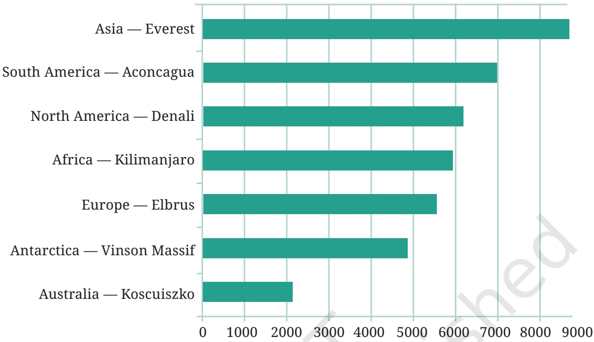
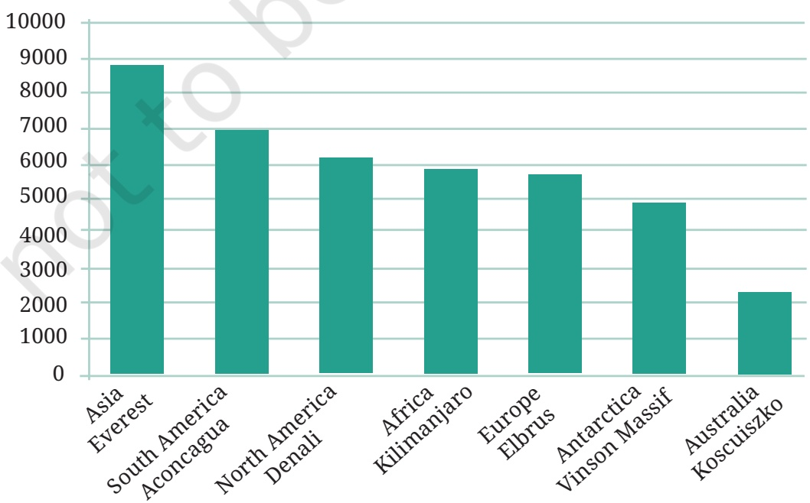

However, since the boxes represent heights, it is better and more visually appealing to rotate the picture, so that the boxes grow upward, vertically from the ground like mountains. A bar graph with vertical bars is also called a column graph. Columns are the pillars you find in a building that hold up the roof.

Below is a column graph for our table of tallest mountains. From this column graph, it becomes easier to compare and visualise the heights of the mountains.

