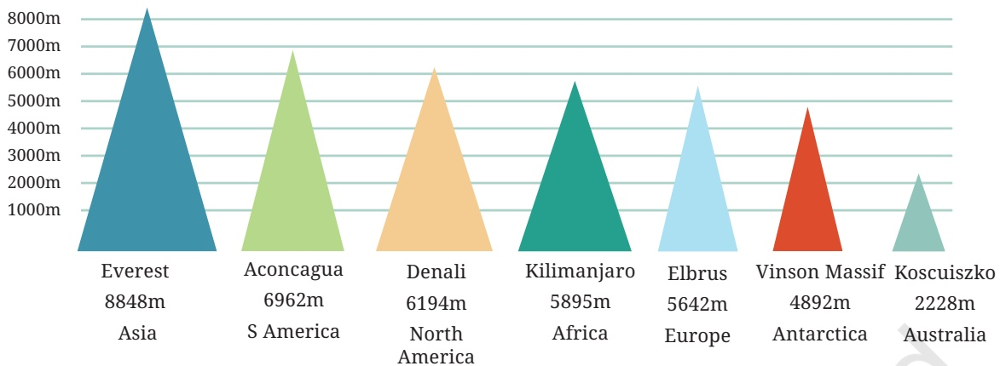

While this infographic might look more appealing and suggestive at first glance, it does have some issues. The goal of our bar graph earlier was to represent the heights of various mountains — using bars of the appropriate heights but the same widths. The purpose of using the same widths was to make it clear that we are only comparing heights. However, in this infographic, the taller triangles are also wider! Are taller mountains always wider? The infographic is implying additional information that may be misleading and may or may not be correct. Sometimes going for more appealing pictures can also accidentally mislead.

Taking this idea further, and to make the picture even more visually stimulating and suggestive, we can further change the shapes of the mountains to make them look even more like mountains, and add other details, while attempting to preserve the heights. For example, we can create an imaginary mountain range that contains all these mountains.

Is the infographic below better than the column graph with rectangular columns of equal width? The mountains look more realistic, but is the picture accurate?

For example, Everest appears to be twice as tall as Elbrus.