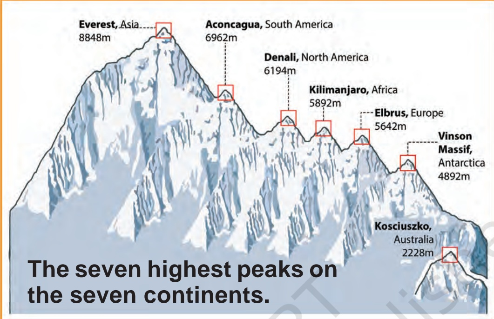

## The seven highest peaks on the seven continents.

What is 5642 × 2?

While preparing visually-appealing presentations of data, we also need to be careful that the pictures we draw do not mislead us about the facts. In general, it is important to be careful when making or reading infographics, so that we do not mislead our intended audiences and we, ourselves, are not misled.

## Summary

Facts, numbers, measures, observations and other descriptions of things that convey information about those things is called **data**.

■ Data can be organised in a tabular form using tally marks for easy analysis and interpretation.

**Frequencies** are the counts of the occurrences of values, measures or observations.