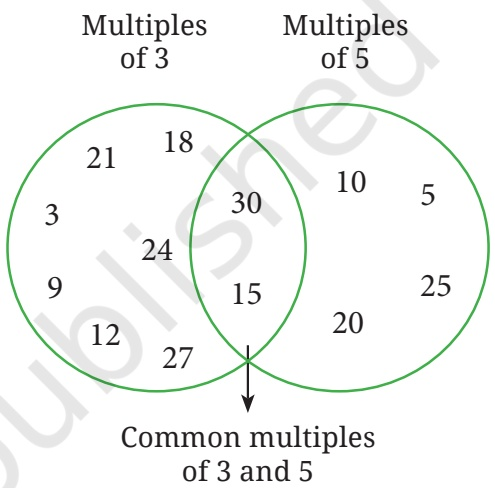
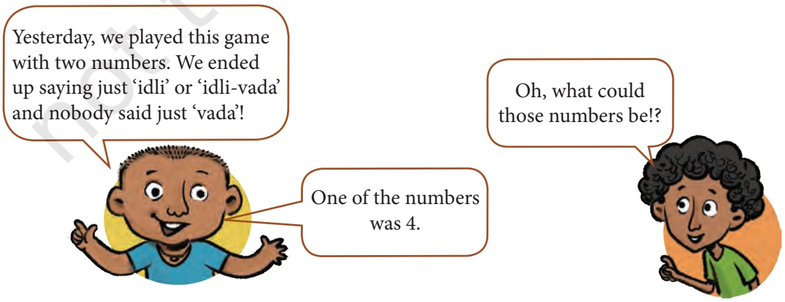

## Figure it Out

1. At what number is ‘idli-vada’ said for the 10th time?

2.	 If the game is played for the numbers 1 to 90, find out:

a. How many times would the children say ‘idli’ (including the times they say ‘idli-vada’)?

b. How many times would the children say ‘vada’ (including the times they say ‘idli-vada’)?

c. How many times would the children say ‘idli-vada’?

3. What if the game was played till 900? How would your answers change?

4.	 Is this figure somehow related to the ‘idli-vada’ game?

Hint: Imagine playing the game till 30. Draw the figure if the game is played till 60.

Let us now play the ‘idli-vada’ game with different pairs of numbers:

Fig. 5.1

a. 2 and 5,

b. 3 and 7,

c. 4 and 6.

We will say ‘idli’ for multiples of the smaller number, ‘vada’ for multiples of the larger number and ‘idli-vada’ for common multiples. Draw a figure similar to Fig. 5.1 if the game is played up to 60.

