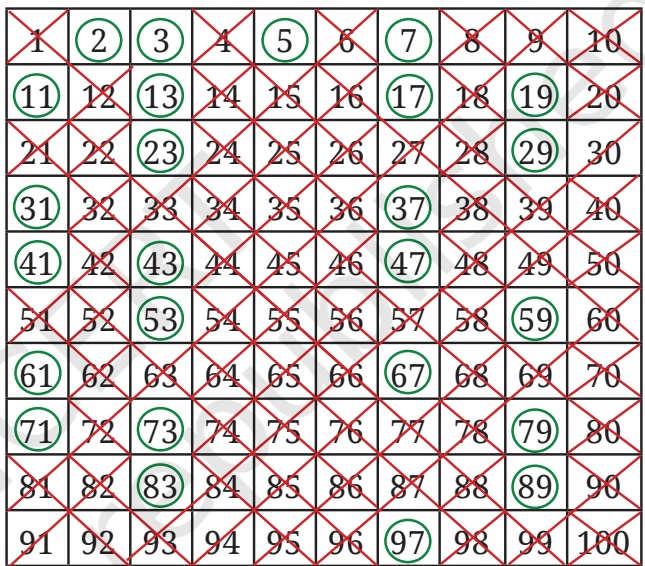
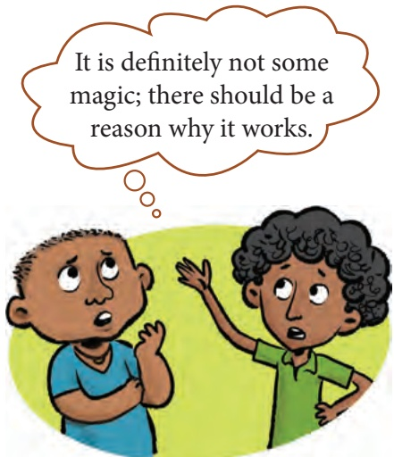

What about 1, which has only one factor? The number 1 is neither a prime nor a composite number.

How many prime numbers are there from 21 to 30? How many composite numbers are there from 21 to 30?

**Can we list all the prime numbers from 1 to 100?**

Here is an interesting way to find prime numbers. Just follow the steps given below and see what happens.

**Step 1:** Cross out 1 because it is neither prime nor composite.

**Step 2:** Circle 2, and then cross out all multiples of 2 after that, i.e., 4, 6, 8, and so on.

**Step 3:** You will find that the next uncrossed number is 3. Circle 3 and then cross out all the multiples of 3 after that, i.e., 6, 9, 12, and so on.

**Step 4:** The next uncrossed number is 5. Circle 5 and then cross out all the multiples of 5 after that, i.e., 10, 15, 20, and so on.

**Step 5:** Continue this process till all the numbers in the list are either circled or crossed out.

All the circled numbers are prime numbers. All the crossed out numbers, other than 1, are composite numbers. This method is called the Sieve of Eratosthenes.

This procedure can be carried on for numbers greater than 100 also. Eratosthenes was a Greek mathematician who lived around 2200 years ago and developed this method of listing primes.

It is definitely not some magic; there should be a reason why it works.

