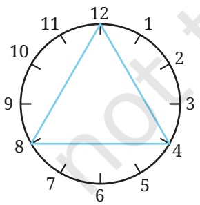
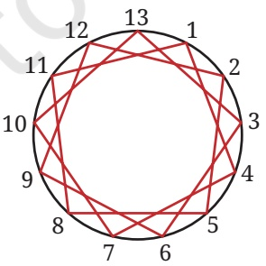
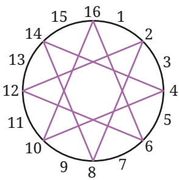
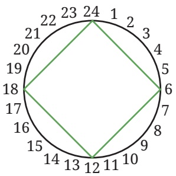

What is special about safe pairs? They don’t have any common factor other than 1. Two numbers are said to be **co-prime** to each other if they have no common factor other than 1.

**Example:** As 15 and 39 have 3 as a common factor, they are not co-prime. But 4 and 9 are co-prime.

嶽 Which of the following pairs of numbers are co-prime? a. 18 and 35 b. 15 and 37 c. 30 and 415 d. 17 and 69 e. 81 and 18

While playing the ‘idli-vada’ game with different number pairs, Anshu observed something interesting!

1. Sometimes the first common multiple was the same as the product of the two numbers.

2. At other times the first common multiple was less than the product of the two numbers.

Find examples for each of the above. How is it related to the number pair being co-prime?

## Co-prime art

Observe the following thread art. The first diagram has 12 pegs and the thread is tied to every fourth peg (we say that the thread-gap is 4). The second diagram has 13 pegs and the thread-gap is 3. What about the other diagrams? Observe these pictures, share and discuss your findings in class.

In some diagrams, the thread is tied to every peg. In some, it is not. Is it related to the two numbers (the number of pegs and the thread-gap) being co-prime?