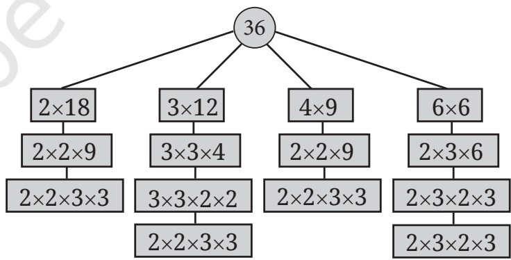

## Prime factorisation

Take a number such as 56. It is composite, as we saw that it can be written as $56 = 4 \times 14.50$ , both 4 and 14 are factors of 56. Now take one of these, say 14. It is also composite and can be written as $1 4 = 2 \times 7 .$ Therefore, $5 6 = 4 \times 2 \times 7$ . Now, 4 is composite and can be written as $4 = 2 \times 2$ . Therefore, $5 6 = 2 \times 2 \times 2 \times 7$ . All the factors appearing here, 2 and 7, are prime numbers. So, we cannot divide them further.

In conclusion, we have written 56 as a product of prime numbers. This is called **prime factorisation** of 56. The individual factors are called prime factors. For example, the prime factors of 56 are 2 and 7.

Every number greater than 1 has a prime factorisation. The idea is the same: keep breaking the composite numbers into factors till only primes are left.

The number 1 does not have any prime factorisation. It is not divisible by any prime number.

What is the prime factorisation of a prime number like 7? It is just 7 (we cannot break it down any further).

Let us see a few more examples.

By going through different ways of breaking down the number, we wrote 63 as $3 \times 3 \times 7$ and as $3 \times 7 \times 3$ . Are they different? Not really! The same prime numbers 3 and 7 occur in both cases. Further,

3 appears two times in both and 7 appears once.

Here, you see four different ways get prime factorisation of 36. Observe that in all four cases, we get two 2s and two 3s.

Multiply back to see

that you get 36 in all four cases.

For any number, it is a remarkable fact that there is only one prime factorisation, except that the prime factors may come in different