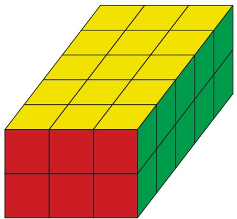

orders. As we explain below, the order is not important. However, as we saw in these examples, there are many ways to arrive at the prime factorisation!

**Does the order matter?**

Using this diagram,

can you explain why $3 0 = 2 \times 3 \times 5 ;$ **,** no matter which way you multiply 2, 3, and 5?

When multiplying numbers, we can do so in any order. The end result is the same. That is why, when two 2s and two 3s are multiplied in any order, we get 36. In a later class, we shall study this under the names of **commutativity and associativity of multiplication**.

Thus, the order does not matter. Usually we write the prime numbers in increasing order. For example, $2 2 5 = 3 \times 3 \times 5 \times 5$ or 30 = $2 \times 3 \times 5$

## Prime factorisation of a product of two numbers

When we find the prime factorisation of a number, we first write it as a product of two factors. For example, $7 2   =   1 2   \times   6$ . Then, we find the prime factorisation of each of the factors. In the above example, $1 2 = 2 \times 2 \times 3$ and 6 = 2 × 3. Now, can you say what the prime factorisation of 72 is?

The prime factorisation of the original number is obtained by putting these together.

$$
7 2 = 2 \times 2 \times 3 \times 2 \times 3
$$