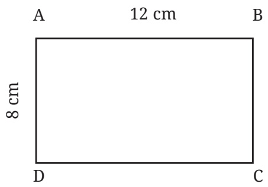

## 6.1 Perimeter

Do you remember what the perimeter of a closed plane figure is? Let us refresh our understanding!

The perimeter of any closed plane figure is the distance covered along its boundary when you go around it once. For a **polygon**, i.e., a closed plane figure made up of line segments, the perimeter is simply the sum of the lengths of its all sides, i.e., the total distance along its outer boundary.

The perimeter of a polygon = the sum of the lengths of its all sides.

Let us revise the formulas for the perimeter of rectangles, squares, and triangles.

## Perimeter of a rectangle

Consider a rectangle ABCD whose length and breadth are 12 cm and 8 cm, respectively. What is its perimeter?

Perimeter of the rectangle = Sum of the lengths of its four sides = AB + BC + CD + DA

