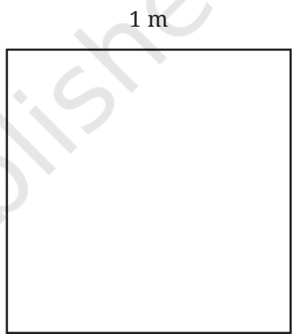

$$
\begin{aligned}&= AB + BC + AB + BC \\&= 2 \times  AB + 2 \times  BC  \\&= 2 \times ( AB  +  BC ) \\&= 2 \times ( 12  cm  + 8  cm  ) \\&= 2 \times ( 20  cm  ) \\&= 40  cm .\end{aligned}
$$

Opposite sides of a rectangle are always equal. So, AB = CD and AD = BC

From this example, we see that —

Perimeter of a rectangle = length + breadth + length + breadth.

Perimeter of a rectangle = 2 × (length + breadth).

The perimeter of a rectangle is twice the sum of its length and breadth.

## Perimeter of a square

Debojeet wants to put coloured tape all around a square photo frame of side 1m as shown. What will be the length of the coloured tape he requires? Since Debojeet wants to put the coloured tape all around the square photo frame, he needs to find the perimeter of the photo frame.

Thus, the length of the tape required = perimeter of the square

= sum of the lengths of all four sides of the square

$$
1 \mathrm{~m}+1 \mathrm{~m}+1 \mathrm{~m}+1 \mathrm{~m}=4 \mathrm{~m}.
$$

Now, we know that all four sides of a square are equal in length. Therefore, in place of adding the lengths of each side, we can simply multiply the length of one side by 4.

Thus, the length of the tape required = 4 × 1 m = 4 m.

From this example, we see that

Perimeter of a square = 4 × length of a side.

The perimeter of a square is quadruple the length of its side.