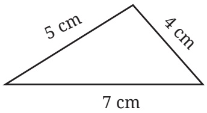
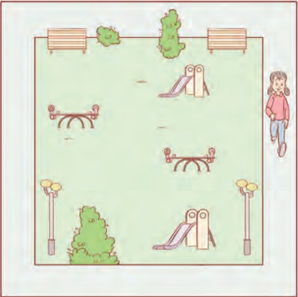

## Perimeter of a triangle

Consider a triangle having three given sides of lengths 4 cm, 5 cm and 7 cm. Find its perimeter. Perimeter of the triangl $\begin{aligned} e  &= 4   cm  + 5   cm  + 7 \\&= 16   cm .\end{aligned}$ cm

Perimeter of a triangle = sum of the lengths of its three sides.

**Example:** Akshi wants to put lace all around a rectangular tablecloth that is 3 m long and 2 m wide. Find the length of the lace required.

## Solution

Length of the rectangular table cover = 3 m. Breadth of the rectangular table cover = 2 m. Akshi wants to put lace all around the tablecloth.

Therefore, the length of the lace required will be the perimeter of the rectangular tablecloth.

Now, the perimeter of the rectangular tablecloth = 2 × (length + breadth) = 2 × (3 m + 2 m) = 2 × 5 m = 10 m.

Hence, the length of the lace required is 10 m.

**Example:** Find the distance travelled by Usha if she takes three rounds of

a square park of side 75 m.

## Solution

Perimeter of the square park = 4 × length of a side = 4 × 75 m = 300 m.

Distance covered by Usha in one round = 300 m.

Therefore, the total distance travelled by Usha in three rounds $3 \times 300    m  = 900    m$

