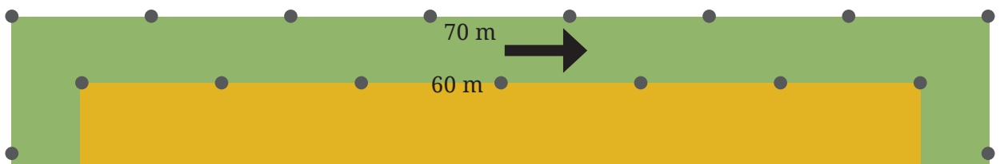
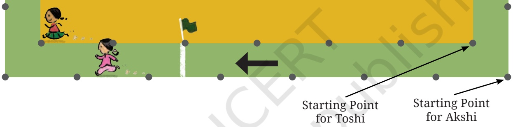

## Matha Pachchi!

Akshi and Toshi start running along the rectangular tracks as shown in the figure. Akshi runs along the outer track and completes 5 rounds. Toshi runs along the inner track and completes 7 rounds. Now, they are wondering who ran more. Find out who ran the longer distance.

Each track is a rectangle. Akshi’s track has length 70 m and breadth 40 m. Running one complete round on this track would cover 220 m, i.e., 2 × (70 + 40) m 220 m. This is the distance covered by Akshi in one round.

## Figure it Out

1. Find out the total distance Akshi has covered in 5 rounds.

2. Find out the total distance Toshi has covered in 7 rounds. Who ran a longer distance?

3. Think and mark the positions as directed—

a. Mark ‘A’ at the point where Akshi will be after she ran 250 m.

b. Mark ‘B’ at the point where Akshi will be after she ran 500 m.

c. Now, Akshi ran 1000 m. How many full rounds has she finished running around her track? Mark her position as ‘C’.

d. Mark ‘X’ at the point where Toshi will be after she ran 250 m.

e. Mark ‘Y’ at the point where Toshi will be after she ran 500 m.