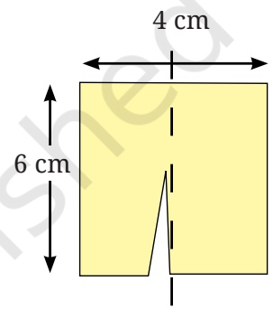
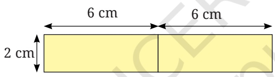
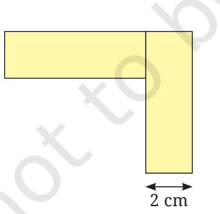
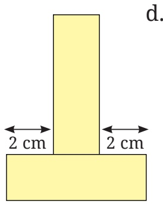
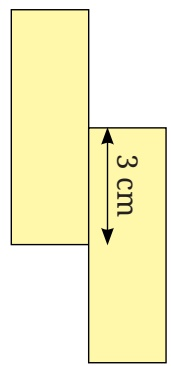

Find various objects from your surroundings that have regular shapes and find their perimeters. Also, generalise your understanding for the perimeter of other regular polygons.

## Teacher’s Note

Discuss more about regular polygons and encourage students to come up with a general formula for the perimeter of a regular polygon.

## Split and rejoin

A rectangular paper chit of dimension 6 cm × 4 cm is cut as shown into two equal pieces. These two pieces are joined in different ways.

a.

For example, the arrangement a. has a perimeter of 28 cm.

Find out the length of the boundary (i.e., the perimeter) of each of the other arrangements below.

b.

c.

d.

Arrange the two pieces to form a figure with a perimeter of 22 cm.