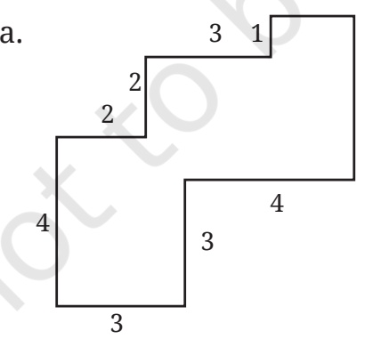
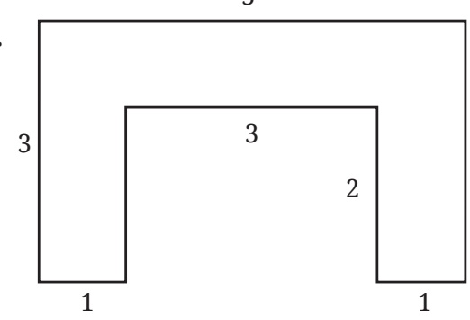

## Solution

Length of the land (l) = 12 m.

Width of land (w) = 10 m.

Area of the whole land = l × w = 12 m × 10 m = 120 sq m.

The sidelength of each of the four square flower beds is (s) = 4 m.

Area of one flower bed $s \times s = 4\  m  \times 4\  m  = 16\  sq \  m$

Hence, the area of the four flower beds = 4 × 16 sq m = 64 sq m.

Therefore, the area of the remaining part of the land is: area of the complete land minus the area of all four flower beds = 120 sq m – 64 sq m = 56 sq m.

## Figure it Out

1. The area of a rectangular garden 25 m long is 300 sq m. What is the width of the garden?

2. What is the cost of tiling a rectangular plot of land 500 m long and 200 m wide at the rate of \` 8 per hundred sq m?

3. A rectangular coconut grove is 100 m long and 50 m wide. If each coconut tree requires 25 sq m, what is the maximum number of trees that can be planted in this grove?

4. By splitting the following figures into rectangles, find their areas (all measures are given in metres).

b.

5

