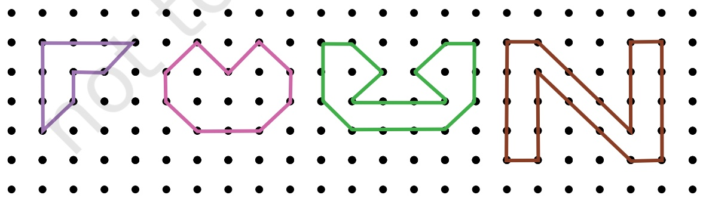
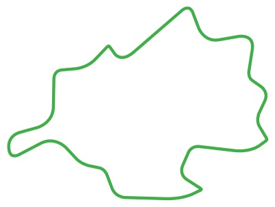
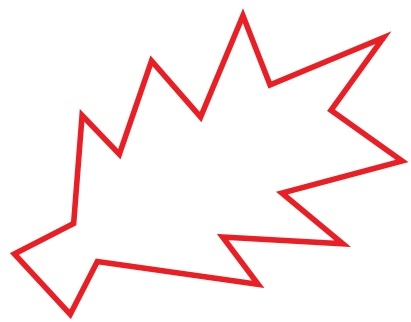

a.

Look at the figures below and guess which one of them has a larger area.

We can estimate the area of any simple closed shape by using a sheet of squared paper or graph paper where every square measures 1 unit × 1 unit or 1 square unit.

To estimate the area, we can trace the shape onto a piece of transparent paper and place the same on a piece of squared or graph paper and then follow the below conventions—

1. The area of one full small square of the squared or graph paper is taken as 1 sq unit.

2. Ignore portions of the area that are less than half a square.

3. If more than half of a square is in a region, just count it as 1 sq unit.

4. If exactly half the square is counted, take its area as $\frac { 1 } { 2 }$ sq unit.

Find the area of the following figures.