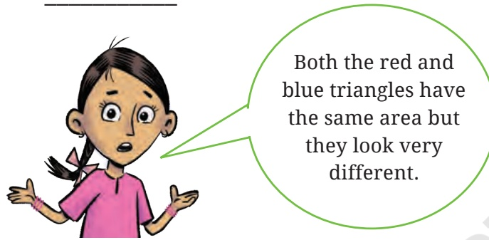
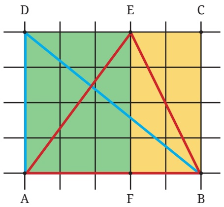
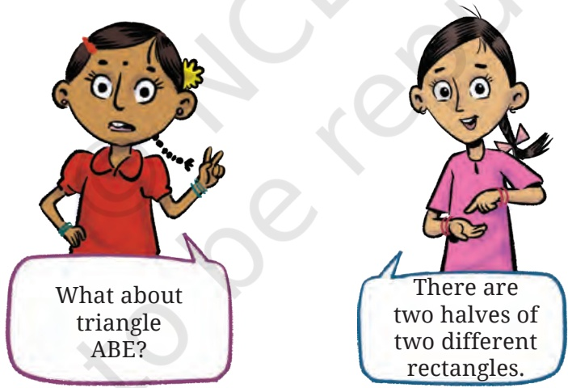

Use your understanding from previous grades to calculate the area of any closed figure using grid paper and —

1. Find the area of blue triangle BAD.

2. Find the area of red triangle ABE.

Both the red and blue triangles have the same area but they look very different.

Area of rectangle ABCD =

So, the area of triangle BAD is half of the area of the rectangle ABCD.

What about triangle ABE?

Area of triangle ABE = Area of triangle AEF + Area of triangle BEF. Here, the area of triangle AEF = half of the area of rectangle AFED. Similarly, the area of triangle BEF = half of the area of rectangle BFEC.

Thus, the area of triangle ABE = half of the area of rectangle AFED +half of the area of rectangle BFEC