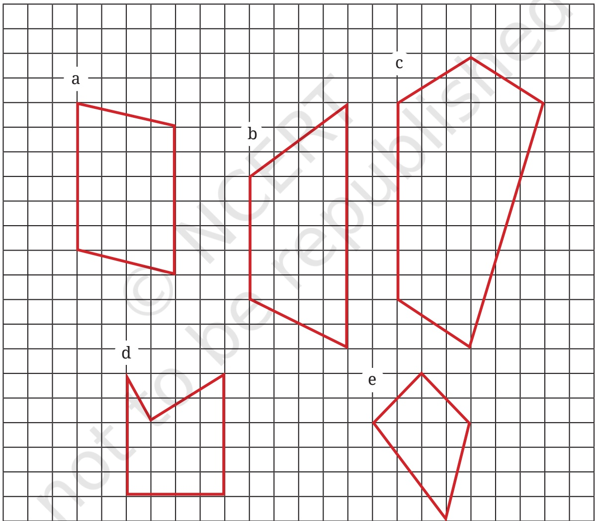

= half of the sum of the areas of the rectangles AFED and BFEC = half of the area of rectangle ABCD.

Conclusion

## Figure it Out

1. Find the areas of the figures below by dividing them into rectangles and triangles.

