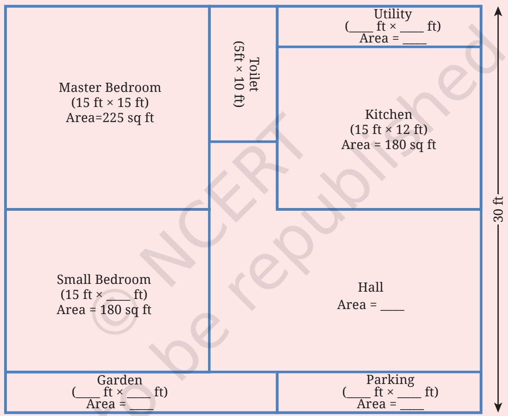

Experiment placing this new square at different places and think what the change in perimeter will be. Can you place the square so that the perimeter: a) increases; b) decreases; c) stays the same?

Below is the house plan of Charan. It is in a rectangular plot. Look at the plan. What do you notice?

Some of the measurements are given.

a. Find the missing measurements.

b. Find out the area of his house.