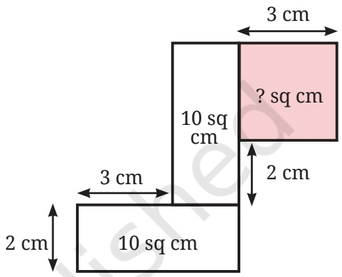
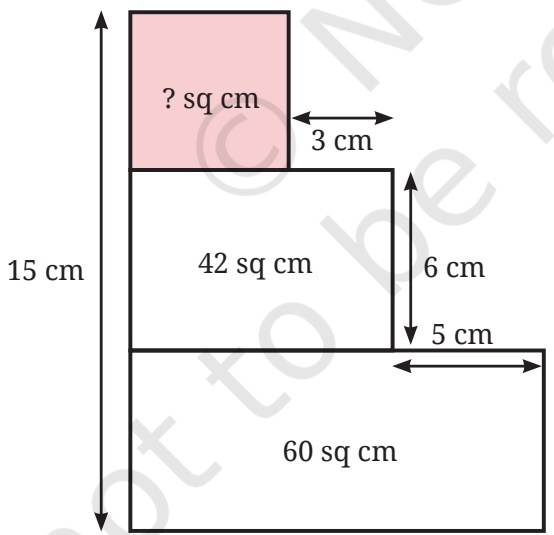
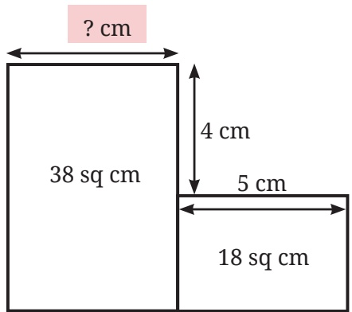

## Area Maze Puzzles

In each figure, find the missing value of either the length of a side or the area of a region.

a.

| 13 sq cm | 26 sq cm |
| --- | --- |
| 15 sq cm | ? sq cm |

b.

c.

d.

