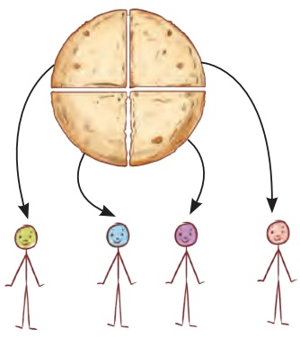

# Fractions

0674CH07

Recall that when some whole number of things are shared equally among some number of people, fractions tell us how much each share is.

Shabnam: Do you remember, if one roti is divided equally between two children, how much roti will each child get?

Mukta: Each child will get half a roti.

Shabnam: The fraction ‘one half’ is written as $\frac { 1 } { 2 }$ . We also sometimes read this as ‘one upon two.’

Mukta: If one roti is equally shared among 4 children, how much roti will one child get?

Shabnam: Each child’s share is $\frac { 1 } { 4 }$ roti.

Mukta: And which is more $\frac { 1 } { 2 }$ roti or $\frac { 1 } { 4 }$ roti?

Shabnam: When 2 children share 1 roti equally, each child gets $\frac { 1 } { 2 }$ roti. When 4 children share 1 roti equally, each child gets $\frac { 1 } { 4 }$ roti. Since, in the second group more children share the

