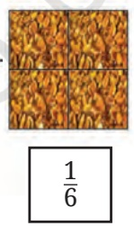
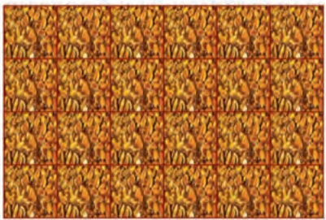
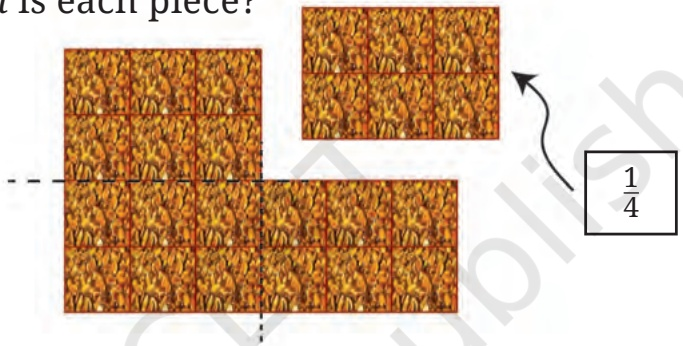
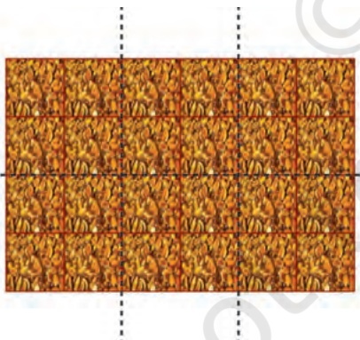
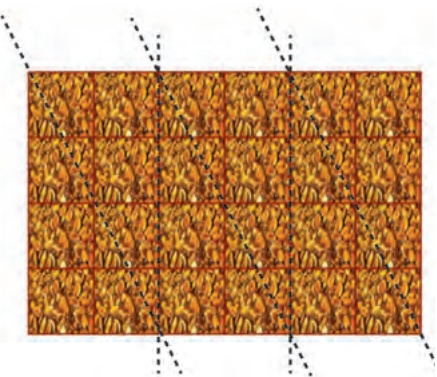
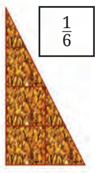

## 7.2 Fractional Units as Parts of a Whole

The picture shows a whole chikki.

A picture of the chikki broken into 2 pieces is shown below. How much of the original chikki is each piece?

A whole chikki

We can see that the bigger piece has 3 pieces of $\frac { 1 } { 4 }$ chikki in it. So, we can measure the bigger piece using the fractional unit $\frac { 1 } { 4 } ,$ . We see that the bigger piece is $\frac{3}{4}$ chikki.

A whole chikki cut into 6 equal pieces.

A whole chikki cut into 6 equal pieces in a different way.

By dividing the whole chikki into 6 equal parts in different ways, we get $\frac{1}{6}$ chikki pieces of different shapes. Are they of the same size?