What is the fractional unit of chikki shown below?

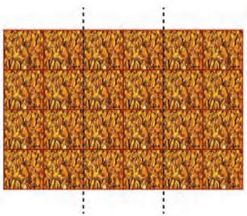

A whole chikki

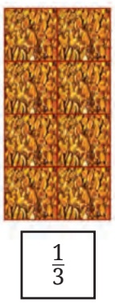

We get this piece by breaking the chikki into 3 equal pieces. So this is $\frac { 1 } { 3 }$ chikki.

## Figure it Out

The figures below show different fractional units of a whole chikki. How much of a whole chikki is each piece?

a.

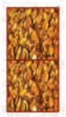

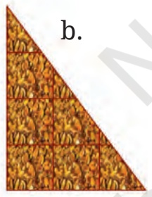

b.

c.

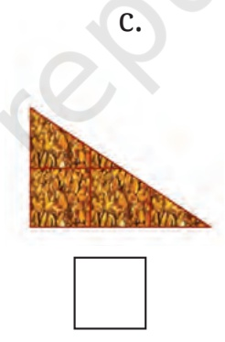

d.

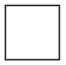

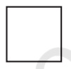

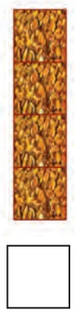

e.

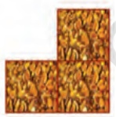

f.

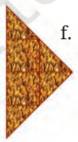

g.

h.

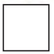

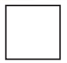

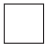

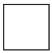