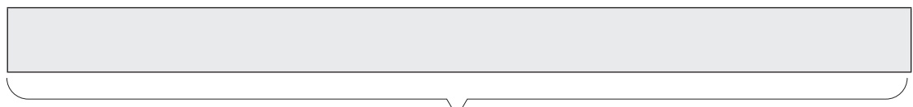
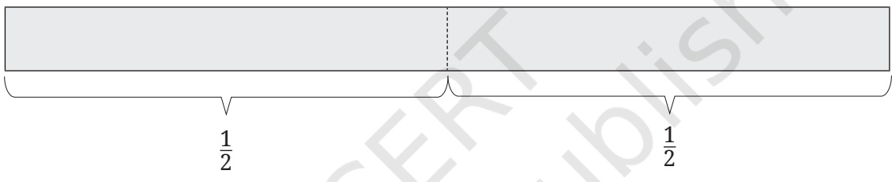
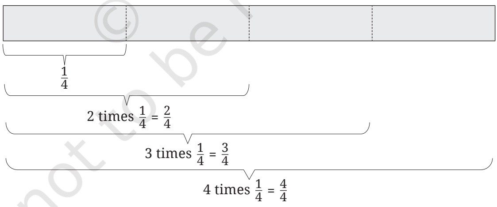

## 7.3 Measuring Using Fractional Units

Take a strip of paper. We consider this paper strip to be one unit long.

1 Strip Paper

Fold the strip into two equal parts and then open up the strip again. Taking the strip to be one unit in length, what are the lengths of the two new parts of the strip created by the crease?

What will you get if you fold the previously-folded strip again into two equal parts? You will now get four equal parts.

**Do it once more! Fill in the blank boxes.**