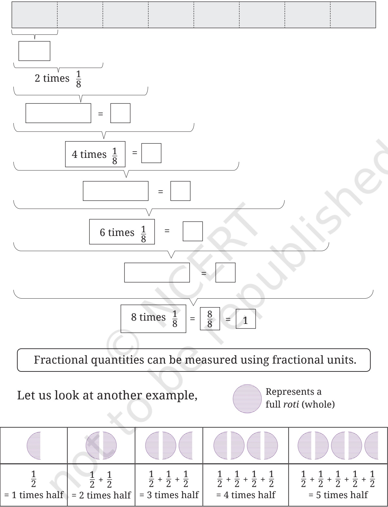

Fractional quantities can be measured using fractional units.

Let us look at another example,

Represents a full roti (whole)

|  |  |  |  |  |
| --- | --- | --- | --- | --- |
| 12= 1 times half | 12 + 12= 2 times half | 12 + 12 + 12= 3 times half | 12 + 12 + 12 + 12= 4 times half | 12 + 12 + 12 + 12 + 12= 5 times half |

We can describe how much the quantity is by collecting together the fractional units.