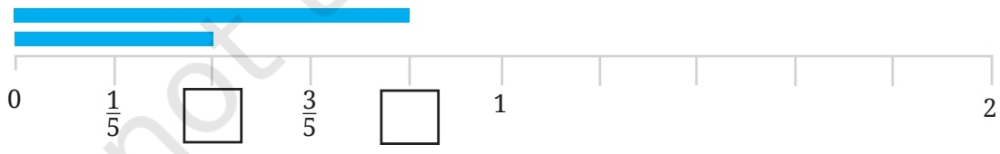

## 7.4 Marking Fraction Lengths on the Number Line

We have marked lengths equal to 1, 2, 3, … units on the number line. Now, let us try to mark lengths equal to fractions on the number line.

What is the length of the blue line? Write the fraction that gives the length of the blue line in the box.

The distance between 0 and 1 is one unit long. It is divided into two equal parts. So, the length of each part is $\frac { 1 } { 2 }$ unit. So, this blue line is $\frac { 1 } { 2 }$ unit long.

Now, can you find the lengths of the various blue lines shown below? Fill in the boxes as well.

1. Here, the fractional unit is dividing a length of 1 unit into three equal parts. Write the fraction that gives the length of the blue line in the box or in your notebook.

2. Here, a unit is divided into 5 equal parts. Write the fraction that gives the length of the blue lines in the respective boxes or in your notebook.

1

3. Now, a unit is divided into 8 equal parts. Write the appropriate fractions in your notebook.