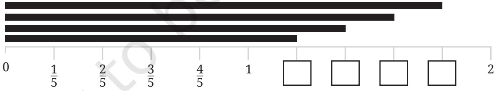

2. Write five more fractions of your choice and mark them on the number line.

3. How many fractions lie between 0 and 1? Think, discuss with your classmates, and write your answer.

4. What is the length of the blue line and black line shown below? The distance between 0 and 1 is 1 unit long, and it is divided into two equal parts. The length of each part is ${ \frac { 1 } { 2 } } .$ . So the blue line $\mathrm { i s } \frac { 1 } { 2 }$ units long. Write the fraction that gives the length of the black line in the box.

5. Write the fraction that gives the lengths of the black lines in the respective boxes.

## Teacher’s Note

Draw these lines on the board and ask the students to write the answers in their notebooks.