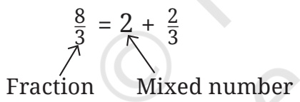

## Figure it Out

1. How many whole units are there in $\frac { 7 } { 2 } ?$

2. How many whole units are there in $\frac{4}{3}$ and in $\frac { 7 } { 3 } ?$

## Writing fractions greater than one as mixed numbers

We saw that: ${ \textstyle { \frac { 3 } { 2 } }   =   1   +   { \frac { 1 } { 2 } } }$

We can write other fractions in a similar way. For example,

$$
{ \frac { 4 } { 3 } }   =   { \underbrace { { \frac { 1 } { 3 } }   +   { \frac { 1 } { 3 } }   +   { \frac { 1 } { 3 } } } _ { } }   +   { \frac { 1 } { 3 } }   =   1   +   { \frac { 1 } { 3 } }   .
$$

$$
3 \times { \textstyle { \frac { 1 } { 3 } } } = 1
$$

## Figure it Out

1. Figure out the number of whole units in each of the following fractions: a. $\frac{8}{3}$ b. $\frac { 1 1 } { 5 }$ . $\frac { 9 } { 4 }$

We saw that

This number is thus also called ‘two and two thirds’. We also write it as $2   \frac { 2 } { 3 }$

Fraction Mixed number

2. Can all fractions greater than 1 be written as such mixed numbers?

## A mixed number or mixed fraction contains a whole number (called the whole part) and a fraction that is less than 1 (called the fractional part).

Write the following fractions as mixed fractions (e.g., $\textstyle { \frac { 9 } { 2 } }   = 4   { \frac { 1 } { 2 } } )$ a. $\frac { 9 } { 2 }$ b. $\frac{9}{5}$ c. $\frac { 2 1 } { 1 9 }$ d. $\frac { 4 7 } { 9 }$ e. $\frac { 1 2 } { 1 1 }$ f. $\frac { 1 9 } { 6 }$