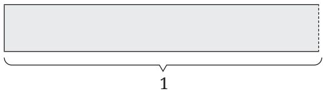
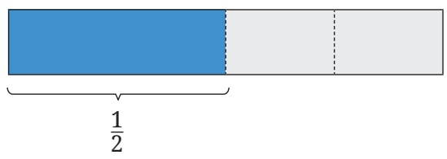
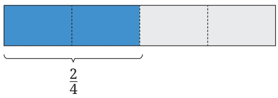
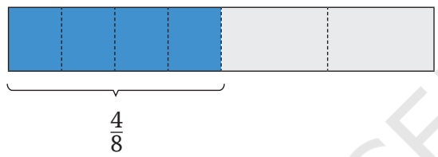

What do you observe?

• Are the lengths $\frac { 1 } { 2 }$ and $\frac { 2 } { 4 }$ equal?

• Are the lengths $\frac { 2 } { 4 }$ and $\frac{4}{8}$ equal? We can say that $\frac{1}{2} = \frac{2}{4} = \frac{4}{8}$ .

These are ‘equivalent fractions’ that denote the same length, but they are expressed in terms of different fractional units.

Now, check whether $\frac { 1 } { 3 }$ and $\frac{2}{6}$ are equivalent fractions or not, using paper strips.

Make your own fraction wall using such strips as given in the picture below!

Answer the following questions after looking at the fraction wall:

1. Are the lengths $\frac { 1 } { 2 }$ and $\frac{3}{6}$ equal?

2. Are $\frac{2}{3}$ and $\frac{4}{6}$ equivalent fractions? Why?

3. How many pieces of length $\frac{1}{6}$ will make a length of $\frac { 1 } { 2 } ?$

<table><tbody><tr><td colspan="12">1 UNIT</td></tr><tr><td colspan="6">12</td><td colspan="6">22</td></tr><tr><td colspan="4">13</td><td colspan="4">23</td><td colspan="4">33</td></tr><tr><td colspan="3">14</td><td colspan="3">24</td><td colspan="3">34</td><td colspan="3">44</td></tr><tr><td colspan="2">15</td><td colspan="3">25</td><td colspan="2">35</td><td colspan="3">45</td><td colspan="2">55</td></tr><tr><td>16</td><td colspan="3">26</td><td colspan="2">36</td><td colspan="2">46</td><td colspan="3">56</td><td>66</td></tr></tbody></table>

4. How many pieces of length $\frac{1}{6}$ will make a length of $\frac { 1 } { 3 } ?$