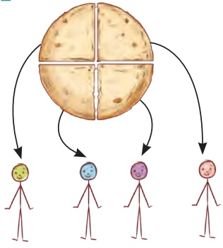

We can extend this idea to make a fraction wall up to the fractional unit $\frac { 1 } { 1 0 }$ . (This fraction wall is given at the end of the book.)

<table><tbody><tr><td colspan="29">1 UNIT</td></tr><tr><td colspan="15">12</td><td colspan="14">22</td></tr><tr><td colspan="10">13</td><td colspan="10">23</td><td colspan="9">33</td></tr><tr><td colspan="8">14</td><td colspan="7">24</td><td colspan="7">34</td><td colspan="7">44</td></tr><tr><td colspan="6">15</td><td colspan="6">25</td><td colspan="6">35</td><td colspan="6">45</td><td colspan="5">55</td></tr><tr><td colspan="5">16</td><td colspan="5">26</td><td colspan="5">36</td><td colspan="5">46</td><td colspan="5">56</td><td colspan="4">66</td></tr><tr><td colspan="4">17</td><td colspan="5">27</td><td colspan="4">37</td><td colspan="4">47</td><td colspan="4">57</td><td colspan="5">67</td><td colspan="3">17</td></tr><tr><td rowspan="2" colspan="3">18</td><td rowspan="2" colspan="5">28</td><td rowspan="2" colspan="3">38</td><td rowspan="2" colspan="4">48</td><td rowspan="2" colspan="4">58</td><td rowspan="2" colspan="3">68</td><td rowspan="2" colspan="5">78</td><td rowspan="2" colspan="2">88</td></tr><tr></tr><tr><td colspan="2">19</td><td colspan="5">29</td><td colspan="3">39</td><td colspan="4">49</td><td colspan="2">59</td><td colspan="4">69</td><td colspan="3">79</td><td colspan="5">89</td><td>99</td></tr><tr><td>1</td><td rowspan="2" colspan="5">210</td><td rowspan="2" colspan="3">310</td><td rowspan="2" colspan="3">410</td><td rowspan="2" colspan="3">510</td><td rowspan="2" colspan="3">610</td><td rowspan="2" colspan="3">710</td><td rowspan="2" colspan="3">810</td><td rowspan="2" colspan="4">910</td><td>10</td></tr><tr><td>10</td><td>10</td></tr></tbody></table>

## Figure it Out

1. Are $\frac{3}{6} ,  \frac{4}{8} ,  \frac{5}{10}$ equivalent fractions? Why?

2. Write two equivalent fractions for $\frac{2}{6}$ .

3. $\frac{4}{6} = \begin{array}{c} \boxed{\quad} \\ \boxed{\quad} \\ \boxed{\quad} \\ \end{array} = \begin{array}{c} \boxed{\quad} \\ \boxed{\quad} \\ \boxed{\quad} \\ \end{array} = \begin{array}{c} \boxed{\quad} \\ \boxed{\quad} \\ \boxed{\quad} \\ \end{array} =$ ... (Write as many as you can)

## Understanding equivalent fractions using equal shares

One roti was shared equally by four children. What fraction of the whole did each child get?

The adjoining picture shows the division of a roti among four children.

Fraction of roti each child got is $\frac { 1 } { 4 } .$

The four shares must be equal to each other!