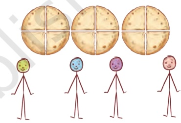

You can also express this event through division facts, addition facts, and multiplication facts.

The division fact is $1 \div 4 = \frac{1}{4}$

The addition fact is $1 \; = \; { \frac { 1 } { 4 } } \; + \; { \frac { 1 } { 4 } } \; + \; { \frac { 1 } { 4 } } \; + \; { \frac { 1 } { 4 } }$

The multiplication fact is $1 = 4 \times { \frac { 1 } { 4 } }$

## Figure it Out

1. Three rotis are shared equally by four children. Show the division in the picture and write a fraction for how much each child gets. Also, write the corresponding division facts, addition facts, and, multiplication facts.

Fraction of roti each child gets is \_\_\_\_\_\_.

Division fact:

Addition fact:

Multiplication fact:

Compare your picture and answers with your classmates!

2. Draw a picture to show how much each child gets when 2 rotis are shared equally by 4 children. Also, write the corresponding division facts, addition facts, and multiplication facts.

3. Anil was in a group where 2 cakes were divided equally among 5   children. How much cake would Anil get?

Now, if there are 10 children in my group, how many cakes will I need so that they get same amount of cake as Anil?

What if we put two such groups together? one group where 2 cakes are divided equally between 5 children, and another group again with 4 cakes and 10 children.

