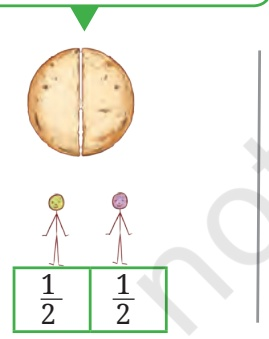
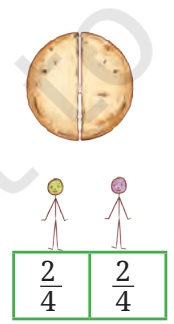
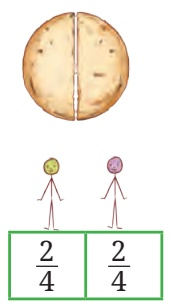
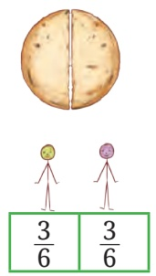
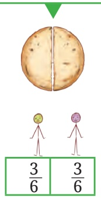
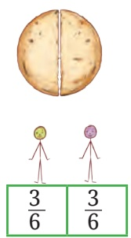

## Group 1

**Group 2**

So, the share of each child is the same in both these situations!

So, 25 = 10 4 !

Let us examine the shares of each child in the following situations.

• 1 roti is divided equally between 2 children.

• 2 rotis are divided equally among 4 children.

• 3 rotis are divided equally among 6 children.

Let us draw and share!

Did you notice that in each situation the share of every child is the same? So, we can say that $\frac{1}{2} = \frac{2}{4} \leq \frac{3}{6}$

1 roti is divided equally between 2

2 rotis are divided equally among 4

3 rotis are divided equally among 6

Fractions where the shares are equal are called ‘equivalent fractions’.