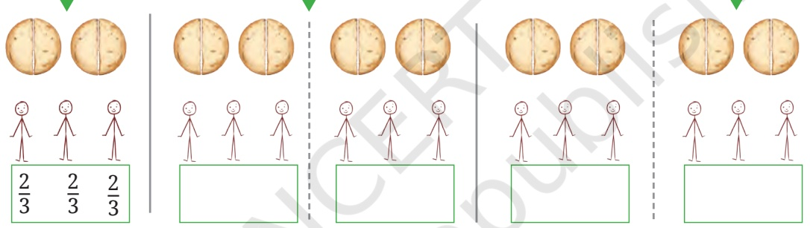
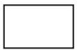
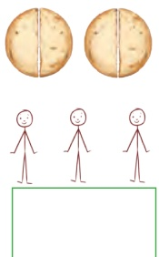

So, $\textstyle { \frac { 1 } { 2 } }   ,   { \frac { 2 } { 4 } }$ , and $\frac{3}{6}$ are all **equivalent fractions**.

Find some more fractions equivalent to $\frac { 1 } { 2 }$ . Write them in the

boxes here:

Equally divide the rotis in the situations shown below and write down the share of each child. Are the shares in each of these cases the same? Why?

2 rotis divided equally among 3 children

4 rotis divided equally among 6 children

6 rotis divided equally among 9 children

$\frac{2}{3}$ is also called the simplest form of $\frac{4}{6}$ . It is also the simplest form of $\frac{6}{9}$ as well.

Do you notice anything about the relationship between the numerator and denominator in each of these fractions?

## Figure it Out

Find the missing numbers:

a. glasses of juice shared equally among 4 friends is the same as \_\_\_\_ glasses of juice shared equally among 8 friends.

So, ${ \frac { 5 } { 4 } } = { \overline { { \frac { } { 8 } } } } .$

b. 4 kg of potatoes divided equally in 3 bags is the same as 12 kgs of potatoes divided equally in \_\_\_ bags.

So, $\frac { 4 } { 3 } = \frac { 1 2 } { \bigtriangleup }$