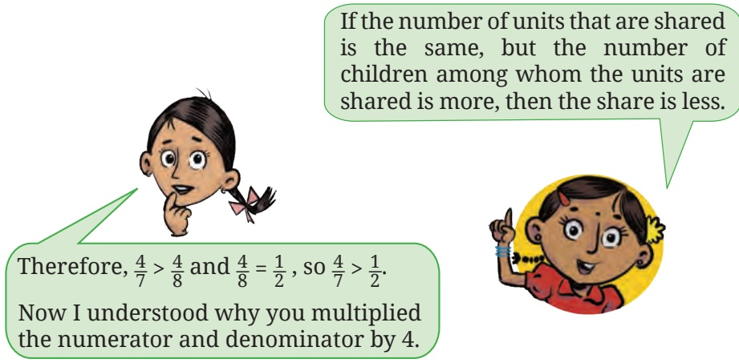

If the number of units that are shared is the same, but the number of children among whom the units are s<u>hared is more, then the share</u> is less.

Suppose the number of children is kept the same, but the number of units that are being shared is increased? What can you say about each child’s share now? Why? Discuss how your reasoning explains $\textstyle { \frac { 1 } { 5 } }   <   { \frac { 2 } { 5 } }   , \; { \frac { 3 } { 7 } }   <   { \frac { 4 } { 7 } }$ , and $\frac { 1 } { 2 } \; < \; \frac { 5 } { 8 }$

Now, decide in which of the two groups will each child get a larger share:

1. **Group 1 :** 3 glasses of sugarcane juice divided equally among 4 children.

**Group 2:** 7 glasses of sugarcane juice divided equally among 10 children.

2. **Group 1 :** 4 glasses of sugarcane juice divided equally among 7 children.

**Group 2:** 5 glasses of sugarcane juice divided equally among 7 children.

Which groups were easier to compare? Why?

When the number of children is same, it is easier to compare, isn’t it?

Shabnam: To compare the first two groups, we have to find fractions equivalent to the fractions $\frac { 3 } { 4 }$ and $\frac { 7 } { 1 0 }$

Mukta: How about $\frac{6}{8}   =   \frac{3}{4}$ and ${ \frac { 2 1 } { 3 0 } }   =   { \frac { 7 } { 1 0 } }   ?$

