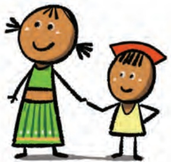
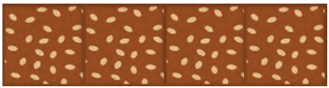
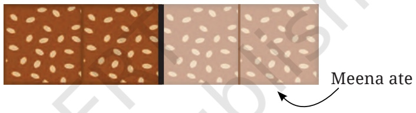
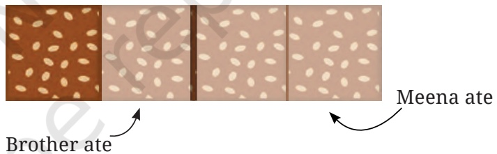
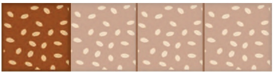

## 7.8 Addition and Subtraction of Fractions

Meena’s father made some chikki. Meena ate $\frac { 1 } { 2 }$ of it and her younger brother ate $\frac { 1 } { 4 }$ of it. How much of the total chikki did Meena and her brother eat together?

We can arrive at the answer by visualising it. Let us take a piece of chikki and divide it into two halves first like this.

Meena ate $\frac { 1 } { 2 }$ of it as shown in the picture.

Let us now divide the remaining half into two further halves as shown. Each of these pieces is $\frac { 1 } { 4 }$ of the whole chikki.

Meena’s brother ate $\frac { 1 } { 4 }$ of the whole chikki, as is shown in the picture.

Brother ate 51

The total chikki eaten is $\frac { 1 } { 2 }$ (by Meena) and $\frac { 1 } { 4 }$ (by her brother)

The total chikki eaten

$$
= { \frac { 1 } { 2 } } + { \frac { 1 } { 4 } }
$$

Total chikki eaten

$$
\frac{1}{4} + \frac{1}{4} + \frac{1}{4}
$$

$$
= 3 \times { \frac { 1 } { 4 } } = { \frac { 3 } { 4 } } .
$$

How much of the total chikki is remaining?