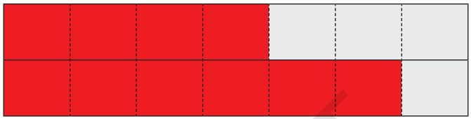
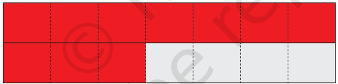

and $\frac { 6 } { 7 }$ will be represented as —

In this case, the total number of shaded parts is 10, and each shaded part represents the fractional unit ${ \frac { 1 } { 7 } } ,$ so, the 10 shaded parts together represent the fraction $\frac { 1 0 } { 7 }$ as seen here.

While adding fractions with the same fractional unit, just add the number of fractional units from each fraction.

Therefore, $\begin{aligned}\frac{4}{7} + \frac{6}{7} &= \frac{10}{7} \\&= 1 \pm \frac{3}{7} \\&= 1\frac{3}{7}\end{aligned}$

Try adding ${ \frac { 4 } { 7 } } + { \frac { 6 } { 7 } }$ using a number line. Do you get the same answer?

**Adding fractions with different fractional units or denominators**

**Example**: Find the sum of $\frac { 1 } { 4 }$ and ${ \frac { 1 } { 3 } } .$

To add fractions with different fractional units, first convert the fractions into equivalent fractions with the same denominator or